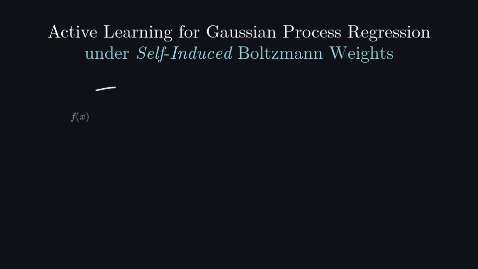

<div align="center">

# SIDAL

### Active Learning for Gaussian Process Regression Under Self-Induced Boltzmann Weights

**Jixiang Qing · Henry Moss · Matthias Sachs**

NeurIPS 2026



</div>

---

## Overview

SIDAL learns an unknown function accurately where it matters: in the regions favoured by a Boltzmann distribution that the function itself induces, such as the low-energy configurations of a molecular system or the highest-scoring compounds in a drug-discovery screen. This repository contains our methods **AB-SID-iVAR** and **TS-SID-iVAR**, the baselines (RS, US, IMSE, EPIG, GHAL), and everything needed to reproduce the paper's experiments.

## Installation

```bash
git clone https://github.com/TsingQAQ/SIDAL.git
cd SIDAL
pip install -e .                 # core: synthetic benchmarks
pip install -e ".[pes]"          # + potential energy surfaces (ase, mace-torch, quippy-ase)
pip install -e ".[molecular]"    # + GuacaMol drug discovery (rdkit, gauche)
pip install -e ".[all]"          # everything, including plotting and tests
```

BoTorch is pinned to `0.16.0` (with GPyTorch `1.14.2`), the stack the paper results were produced with.

## Quick start

Run one experiment from the paper (Branin 2D, AB-SID-iVAR, seed 0):

```bash
python -m sidal.benchmarking.runner \
    --config exps/configs/2d_Branin/matern52/config.json \
    --acq_index 6 --seed 0 --domain c
```

- `--domain`: `c` for continuous, `d` for discrete grid, `p` for pool (molecular tasks).
- `--acq_index`: the method's position in the config's `acquisition_functions` list.

Results are saved as `.pt` files under `exps/results/`.

## Reproducing the paper

Each paper experiment is a config in `exps/configs/`. On a SLURM cluster, `run_benchmark_array.sh` runs every method × seed of one config as a job array:

```bash
# Print the number of tasks for a config
bash exps/scripts/run_benchmark_array.sh -c 2d_Branin/matern52 --count

# Submit all of them (continuous domain)
sbatch --array=0-359 exps/scripts/submit_slurm.sh -s run_benchmark_array.sh -c 2d_Branin/matern52 -dm c
```

The scripts in `fig_scripts/` regenerate the paper figures from `exps/results/`.

Without SLURM, run all methods and seeds of a config locally in parallel:

```bash
bash exps/scripts/run_local_single_config.sh -c exps/configs/2d_Branin/matern52/config.json -p 8 -dm c
```

## Data

- `exps/data/guacamol_train_data_first_20k_dedup.csv`: the first 20k deduplicated molecules of the GuacaMol training set ([Brown et al., 2019](https://doi.org/10.1021/acs.jcim.8b00839)).
- `exps/oracles/*.pt`: precomputed evaluation grids for the PES benchmarks; `exps/scripts/create_*_eval_grid.py` shows how each was made.
- `src/sidal/test_functions/h2Cu/`: MACE model and Cu(100) slab for the H₂/Cu benchmark, taken from [wgst/ml-gas-surface](https://github.com/wgst/ml-gas-surface) (MIT; see the `LICENSE` and `README.md` in that folder). The model is from [Stark et al., 2024](https://doi.org/10.1088/2632-2153/ad5f11), trained on DFT data from [Stark et al., 2023](https://doi.org/10.1021/acs.jpcc.3c06648); the slab comes from the scattering simulations of [Stark et al., 2025](https://doi.org/10.1103/h7vd-94pk).

## Citation

If you find this work or repository helpful, please kindly consider citing our work:

```bibtex
@article{qing2026sidal,
  title   = {Active Learning for Gaussian Process Regression Under Self-Induced Boltzmann Weights},
  author  = {Qing, Jixiang and Moss, Henry and Sachs, Matthias},
  journal = {arXiv preprint arXiv:2605.10654},
  year    = {2026}
}
```

## Acknowledgements

This work was supported by Research England under the Expanding Excellence in England (E3) funding stream, awarded to MARS: Mathematics for AI in Real-world Systems in the School of Mathematical Sciences at Lancaster University. We gratefully acknowledge the use of Lancaster University's High End Computing (HEC) facility, and thank [Yueqi Cao](https://scholar.google.com/citations?user=JlKKsdAAAAAJ&hl=en&oi=ao) for helpful discussions on the theoretical analysis. The code builds on [BoTorch](https://botorch.org) and [GPyTorch](https://gpytorch.ai).

## License

MIT. See [`LICENSE`](LICENSE).
